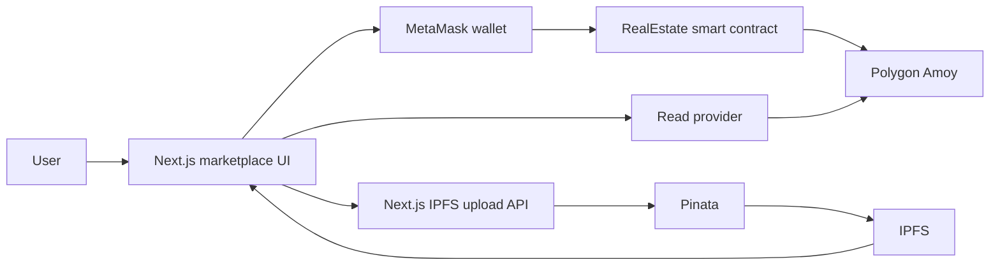

# Kevintrolix RealX

Kevintrolix RealX is an on-chain property marketplace from [Kevintrolix](https://www.kevintrolix.com). People discover listings, connect a wallet, and transfer ownership through a Solidity contract on Polygon. Property images stay on IPFS. Marketplace records stay on-chain.

An on-chain record in RealX is the marketplace listing and its current owner. It is not a government land-registry entry, deed, or investment product.

## Features

### Marketplace

- Create a listing with title, category, address, description, price, and image.
- Browse properties from the home page, Explore, and category collections.
- Open a property for ownership, price, network, and reviews.
- Rank creators by portfolio value and properties by listed price.
- Show the properties held by the connected wallet.

### Ownership and transactions

- Connect MetaMask or another EIP-1193 wallet.
- Detect Polygon Amoy and switch to chain ID `80002`.
- Purchase a property for its exact listed value.
- Pay the current owner and update the owner in the same transaction.
- Allow only the current owner to change property details or price.
- Show transaction progress, rejection, and contract errors.

### Reviews

- Publish a one-to-five-star review with a comment.
- Show review count and rating.
- Mark a review as helpful once per wallet.
- Rank the highest-rated property, using review count when averages tie.

### Media

- Accept a public image URL or a direct upload.
- Pin uploads through a server-side Pinata route.
- Store an `ipfs://` reference on the listing.
- Display IPFS images through a configurable gateway.
- Accept JPEG, PNG, WebP, GIF, and AVIF up to 5 MB.

## Technology stack

| Layer | Technology | Purpose |
|---|---|---|
| Frontend | Next.js 13.4.1 and React 18.2 | Pages, marketplace UI, routing, and server API routes |
| Blockchain client | ethers.js 5.7 | Read providers, wallet signer, contract calls, and transaction receipts |
| Wallet | MetaMask / EIP-1193 | Account selection, chain switching, and transaction approval |
| Smart contract | Solidity `^0.8.9` | Listings, ownership, purchases, prices, reviews, likes, and listing fees |
| Contract toolchain | Hardhat and Chai | Compilation, tests, and deployment |
| Network | Polygon Amoy, chain ID `80002` | EVM network for the current release. Currency is POL |
| Media storage | Pinata and IPFS | Content-addressed property images |
| Application API | Next.js `/api/health` and `/api/ipfs/upload` | Health reporting and server-side image pinning |

## System architecture



The upload route runs on the Next.js server, so the Pinata credential stays off the browser. When a contract address is configured, property and review state comes from Polygon Amoy. When it is not configured, the interface uses local marketplace records.

### Data placement

| Data | Storage location | Reason |
|---|---|---|
| Property owner, price, title, category, address, description, and image reference | Polygon Amoy contract | Public marketplace state that buyers and sellers can verify |
| Reviews and helpful-vote counts | Polygon Amoy contract | Feedback stays with the listing, and the contract rejects a second like from the same wallet |
| Property image bytes | IPFS through Pinata, or a public image URL | Image files are too large to store directly in the contract |
| Marketplace records before a contract is configured | Browser local storage | Keeps discovery, create, and review flows available during setup |
| Deployment private key | Local `web3/.env` only | Used by deploy scripts. Never sent to the browser and never committed |
| Pinata JWT | Local `client/.env.local` only | Used by the server upload route. Must not use a `NEXT_PUBLIC_` prefix |

## Current status

Shipped in this repository:

- Marketplace UI for discovery, listing, purchase, owner updates, reviews, rankings, and wallet connection.
- `RealEstate` contract with Hardhat coverage for listing, owner updates, exact-price purchase, reviews, likes, and listing fees.
- Polygon Amoy configuration, deployment scripts, and a deployment manifest.
- Server-side IPFS upload and a health endpoint.
- Security checks for secrets, response headers, and server-only credentials.

In progress before the next public release:

- Pinata account and server-only JWT for live image uploads.
- Funded Amoy deployment wallet and a published contract address for the frontend.
- Multi-wallet checks for list, update, purchase, review, and ownership transfer.
- Privacy, contact, and support review.

## Roadmap

RealX is the property marketplace on the Kevintrolix RWA roadmap. The table follows the company stack at [kevintrolix.com/stack](https://www.kevintrolix.com/stack).

| Layer | Target | Status |
|---|---|---|
| RWA tokenization | Property marketplace records, then issuance, custody, and secondary liquidity | Marketplace records are in the contract. Issuance and custody are next |
| Identity | ONCHAINID and investor-ready access | Planned |
| Chains | Polygon, Ethereum, Base, and Solana | Polygon Amoy is active |
| Backend | Node.js, TypeScript, Express or NestJS, PostgreSQL, Redis | Next.js API routes are active. Dedicated services are planned |
| Web3 libraries | ethers.js, viem, wagmi, WalletConnect | ethers.js is active. viem, wagmi, and WalletConnect are planned |
| Frontend | React, Next.js, TypeScript, Tailwind CSS | React and Next.js are active. TypeScript and Tailwind are planned |
| Oracle and data | Chainlink, Proof of Reserve, and indexing | Planned. IPFS media is active |
| Infrastructure | Docker, AWS, GitHub Actions | Planned |
| Security | Hardhat, Foundry, Slither, OpenZeppelin, and contract audits | Hardhat tests and release checks are active. Foundry, Slither, OpenZeppelin, and an external audit are planned |

Product direction for tokenized real estate, funds, and investor reporting is described at [kevintrolix.com/solutions/rwa-tokenization](https://www.kevintrolix.com/solutions/rwa-tokenization).

## Repository layout

```text
Kevintrolix_RealX/
├── client/                  Next.js application
│   ├── pages/               Routes and API handlers
│   ├── PageComponents/      Marketplace sections
│   ├── context/             Wallet, properties, and reviews
│   ├── services/            Web3, validation, and media helpers
│   ├── constants/           ABI and Polygon Amoy configuration
│   └── scripts/             Data, security, smoke, and release checks
├── web3/                    Solidity and Hardhat
│   ├── contracts/RealState.sol
│   ├── test/RealEstate.test.js
│   └── scripts/             Deploy and Amoy checks
├── DEPLOYMENT_CHECKLIST.md
└── README.md
```

Main routes: `/` home, `/explor` browse, `/create` list, `/detail` property, `/connect` wallet, `/author` portfolio, `/about` project.

## Getting started

Requirements: Node.js 18 or newer, npm, and MetaMask or another EIP-1193 wallet for on-chain transactions. Use a wallet funded with test POL only.

```bash
cd client
npm ci
npm run dev
```

Open [http://localhost:3000](http://localhost:3000).

Contract tests:

```bash
cd web3
npm ci
npm test
```

Application checks, from `client/`:

```bash
npm run test:data
npm run test:completeness
npm run check:security
npm run build
npm run test:smoke
```

Start `npm run dev` before `test:smoke`.

### Polygon Amoy

1. Copy `web3/.env.example` to `web3/.env` and set `PRIVATE_KEY` to a test-only deployer key.
2. From `web3/`, run `npm run check:amoy`, then `npm run deploy:amoy`.
3. Copy `client/.env.example` to `client/.env.local`.
4. Set `NEXT_PUBLIC_REAL_ESTATE_CONTRACT` to the deployed address.
5. Set `PINATA_JWT` for image upload. Do not prefix it with `NEXT_PUBLIC_`.
6. Start the client and switch the wallet to Polygon Amoy (`80002`).

## Environment

| Variable | File | Visible in the browser | Purpose |
|---|---|---|---|
| `PRIVATE_KEY` | `web3/.env` | No | Signs Amoy deployment transactions |
| `POLYGON_AMOY_RPC_URL` | `web3/.env` | No | Hardhat deployment and verification |
| `NEXT_PUBLIC_REAL_ESTATE_CONTRACT` | `client/.env.local` | Yes | Contract the marketplace reads and writes |
| `NEXT_PUBLIC_POLYGON_AMOY_RPC_URL` | `client/.env.local` | Yes | Read RPC |
| `NEXT_PUBLIC_IPFS_GATEWAY` | `client/.env.local` | Yes | Displays `ipfs://` images |
| `PINATA_JWT` | `client/.env.local` | No | Authenticates server-side IPFS uploads |

Example files contain placeholders only. Populated `.env` files are gitignored.

Further setup notes are in [client/README.md](client/README.md), [web3/README.md](web3/README.md), and [DEPLOYMENT_CHECKLIST.md](DEPLOYMENT_CHECKLIST.md).
